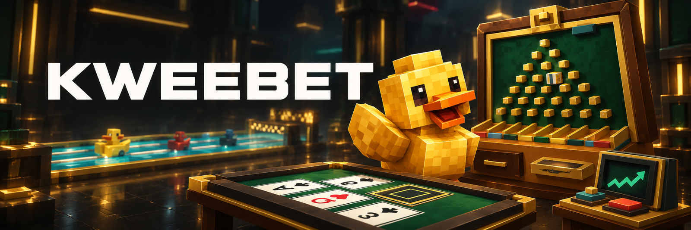
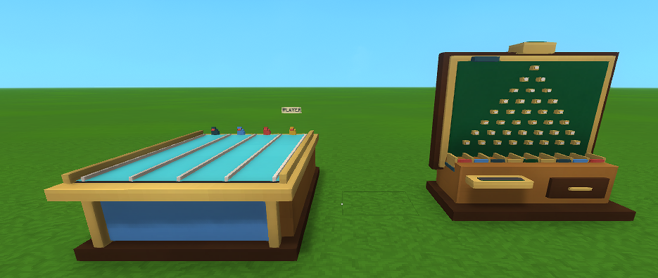

# Kweebet

[Download](https://github.com/jkswoods/Kweebet/releases) · [Player guide](https://jkswoods.github.io/Kweebet/) · [Rules](https://jkswoods.github.io/Kweebet/hytale0.7/games/) · [Report a problem](https://github.com/jkswoods/Kweebet/issues)



**Craft a table, put in some ingots, and play.** Kweebet brings Duck Race, Blackjack, Crash and Plinko to Hytale, with the action visible on the machines in your world.

*Promotional illustration of the mod’s game machines.*



*Kweebet 0.1.0 in Hytale 0.7.4: the placed Duck Race and Plinko machines.*

- **Duck Race:** your marked yellow duck races three server ducks. Win for a 4× total return.
- **Blackjack:** readable table cards, Hit, Stand and Double against the dealer.
- **Crash:** watch the multiplier rise and Take before it crashes. Cash-out is manual.
- **Plinko:** a bouncing ball, eight peg choices, nine payout buckets and a plonk at each peg.
- **Your items:** choose a supported stackable item and bet limits. Returns go to your bag; a full bag retains an owned reward.

## Start playing

1. Install **Kweebet-0.1.0.jar** and enable **Kweebet** for your world.
2. At a stock Workbench, craft a **Kweebet Workbench** with 8 Iron ingots, 4 Copper ingots and 10 wood trunks.
3. Use it to craft a game machine: 6 Iron, 4 Copper and 10 wood trunks each.
4. Place the machine, press Use, choose a bet and play immediately. No house stock or lobby countdown is required.

[Installation and backups](https://jkswoods.github.io/Kweebet/hytale0.7/install-recovery/) · [First session](https://jkswoods.github.io/Kweebet/hytale0.7/first-steps/) · [Recipes](https://jkswoods.github.io/Kweebet/hytale0.7/recipes/) · [Settings](https://jkswoods.github.io/Kweebet/hytale0.7/funding/)

## Compatibility

Version **0.1.0** targets **Hytale 0.7.4** and **Java 25**. This is the first public preview. Multiplayer spectator behaviour and broad server compatibility are still being evaluated; use a backed-up world and replaceable items. There is no real-money or external economy integration.

## Build

Supply your own supported Hytale server JAR and Java 25 JDK, then run:

```sh
python3 tools/build.py
python3 tools/test.py
```

See [building from source](https://jkswoods.github.io/Kweebet/hytale0.7/building/). Proprietary Hytale binaries and assets are not redistributed. Source licensing and generated-asset notices are in [LICENSE](LICENSE) and [THIRD_PARTY_NOTICES.md](THIRD_PARTY_NOTICES.md).

## Compatibility and builds

Current source targets Hytale `>=0.7.4 <0.8.0` and uses the `hytale0.7` support branch. See [build and release instructions](https://jkswoods.github.io/Kweebet/hytale0.7/build-and-release/) for the SDK pin, candidate checks, versioned filenames and CurseForge workflow.

## Contributing

See [the contribution guide](CONTRIBUTING.md) for feature and bug-fix PR targets.
Maintainers handle forward/back ports, and support-branch PRs require owner approval.

## Documentation

The [versioned player guide](https://jkswoods.github.io/Kweebet/) is maintained on the separate [`docs` branch](https://github.com/jkswoods/Kweebet/tree/docs). In that checkout, run `npm ci --ignore-scripts`, `npm run build` and `npm run check`. Select `docs` when manually dispatching its Pages workflow.
