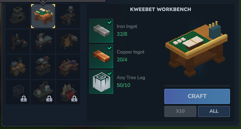

# Your first session

## Make the workbench

At the stock Workbench, open Crafting and make a **Kweebet Workbench** with **8 Iron ingots, 4 Copper ingots and 10 wood trunks**. Place it where there is room for your game machines.

*Native Kweebet 0.1.0 recipe: 8 Iron, 4 Copper and 10 wood trunks.*

Use the new workbench to choose a game recipe. Each machine costs **6 Iron, 4 Copper and 10 wood trunks**. [All recipes](recipes.md).

## Place and open a game

Place the machine on solid ground and leave space around the visible furniture. Press the normal Use key while looking at it. The placing player owns its settings.

Iron ingots are the default wager item. Choose a valid amount with minus, the number field or plus. Settings lets the owner change the accepted item and minimum/maximum bet before a round.

Press **Drop**, **Race**, **Deal** or **Bet**. The game begins immediately. Blackjack offers Hit, Stand and Double; Crash offers Take while your bet is live. Your balance and potential return follow the actual server state.

## Read the result

A large result shows WINNER, YOU LOST, BUST or PUSH, together with the net item change. A positive number is profit after your stake; a negative number is the amount lost. Game rules quote total returns, including your stake.

Winnings return to your bag automatically while the page is open. A full bag retains the owed reward: free space and reopen or Collect. Closing the page does not reroll a round, refund a losing bet or remove its committed result.

Next: [choose a game and read its rules](games.md).
