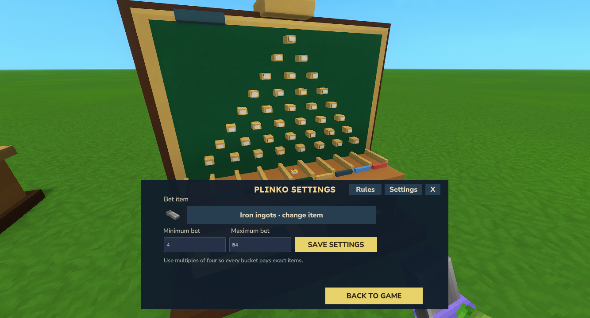

# Game settings

The player who placed the machine owns its settings. Open the machine and choose **Settings** to change:

- The accepted plain stackable item.
- The minimum bet.
- The maximum bet.

*Kweebet 0.1.0: choose the item and limits, then save.*

Save the settings before starting a round. Accepted round terms stay locked while that round is active. Defaults are Iron ingots with a minimum of 4 and maximum of 64.

Blackjack bets must be even so natural-blackjack returns are exact. Plinko bets use multiples of four. Duck Race and Crash use whole items. Equipment and stacks carrying unsupported custom metadata are refused.

There is no house stock to fill, pause switch or lost-bet recovery control. Returns are generated by the game, and losing stakes are consumed. An owed reward held because a bag is full is still collectible.

[Game rules](games.md) · [Save and update](install-recovery.md)
