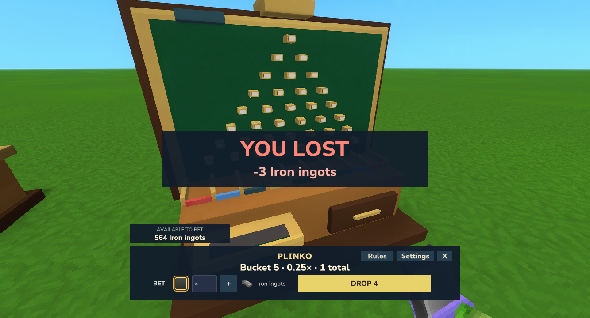

# Plinko

Choose a multiple of four and press **Drop**. The ball starts immediately, bouncing through eight server peg choices into one of nine buckets. Every peg contact has its own short plonk.

| Bucket, left to right | Total multiplier | Return on 4 Iron |
| --- | ---: | ---: |
| 1 / 9 | 10× | 40 |
| 2 / 8 | 3× | 12 |
| 3 / 7 | 1.5× | 6 |
| 4 / 6 | 0.75× | 3 |
| 5 | 0.25× | 1 |

Returns include the committed bet. A 4-Iron drop returning 3 shows a net loss of 1 Iron; a return of 12 shows a net gain of 8. The ball follows its saved outcome, and closing the page cannot reroll it.

*Kweebet 0.1.0 native controls: the large signed result shows net change; the bucket line shows the total return.*

The game generates its own returns; no house funding is required. A full bag keeps an owned reward until space is available. All 256 equally likely paths yield an expected total return of **1014/1024**, or **99.0234375%** of the stake. This is an average over many games, not a promise for an individual drop.

[All game rules](games.md) · [Settings](funding.md)
